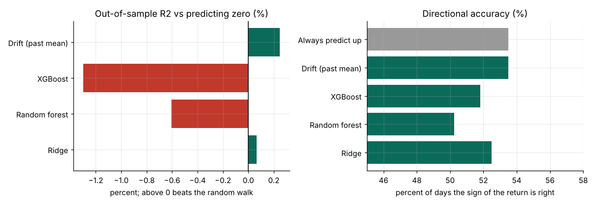
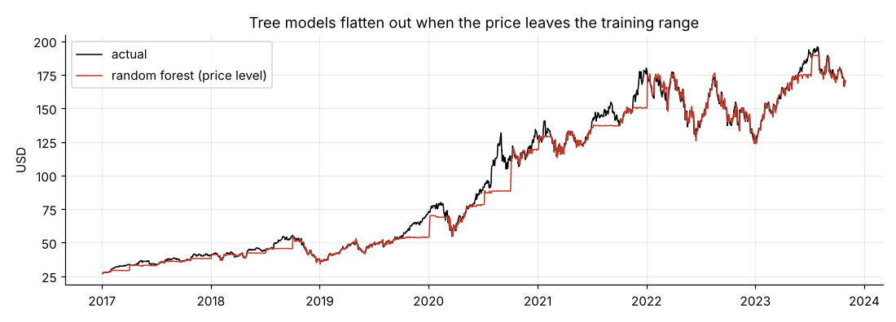

# Can machine learning forecast Apple's stock price?

**A walk-forward test of random forest, XGBoost and ridge regression on daily AAPL data, 2014-2023.**

The original project reported R² = 0.9999 for a random forest "predicting" Apple's closing price. That figure came from predicting today's close from today's open, high, low and adjusted close, on a random train/test split, so it measured nothing about forecasting. I rebuilt it as a real forecast and tested it on years the models never saw.

**Tools:** Python · pandas · scikit-learn · XGBoost · SciPy · matplotlib

📓 **Full analysis:** [`notebooks/apple_stock_forecasting.ipynb`](notebooks/apple_stock_forecasting.ipynb) (also as [HTML](apple_stock_forecasting.html))

## Key findings

| # | Finding | Evidence |
|---|---|---|
| 1 | The original R² of 0.9999 is a leak, not skill. | Target and inputs are the same day's prices; Close and Adj Close correlate at 0.99996; random split lets the model interpolate between neighbouring days. |
| 2 | No model beats "predict no change" on next-day returns. | Out-of-sample R²: ridge +0.1%, random forest −0.6%, XGBoost −1.3% (1,718 walk-forward predictions, 2017-2023). |
| 3 | Direction is no better than always saying "up". | Hit rate 50-53% vs 53.5% for always-up; no significance test below p = 0.3 (and none of the hit-rate tests favour the models). |
| 4 | Trees fail on price levels. | Random forest on the price level: MAE $3.91 vs $1.32 for "tomorrow = today"; forecasts flatten when the price leaves the training range. |





## Method

1. **Audit and reproduce.** Re-create the original setup, show why it is meaningless.
2. **Target and features.** Next-day log return; features known at today's close (multi-horizon returns, volatility, moving-average ratios, volume change, daily range).
3. **Walk-forward evaluation.** Expanding window, refit every 63 trading days from 2017, so every prediction is on unseen future data.
4. **Benchmarks and tests.** Zero (random walk) and historical-drift forecasts; paired squared-error test; binomial test on hit rate.

## Repository structure

```
├── data/aapl_daily.csv                 # 2,475 daily rows, Jan 2014 - Oct 2023
├── notebooks/apple_stock_forecasting.ipynb
├── results/                            # CSV tables written by the notebook
├── figures/
├── apple_stock_forecasting.html        # executed notebook
└── requirements.txt
```

## Reproduce

```bash
pip install -r requirements.txt
cd notebooks && jupyter notebook apple_stock_forecasting.ipynb   # Run All (about a minute)
```

## Limitations

One stock and one decade. Only price-derived features were tested; news, fundamentals or options data were not. No trading strategy or transaction costs are evaluated. Not investment advice.

## Author

Timothy Rimu
